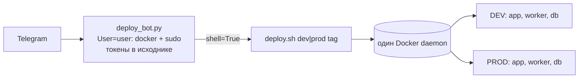
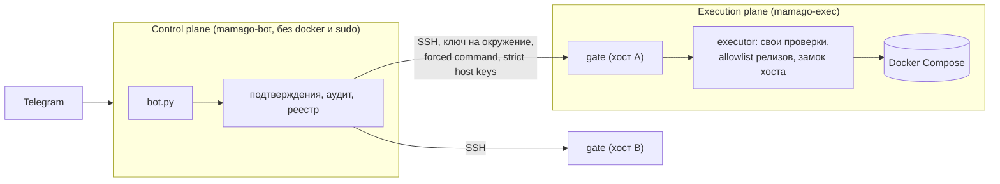

# Система деплоя mamaGo: безопасность, DEV UAT, несколько серверов

**Состояние:** код и тесты готовы. **На сервер ничего не установлено**, действующий бот и его уязвимости остаются как есть до установки.
Код: `scripts/release/deploybot/`. Пошаговые процедуры: `deployment-runbooks.md`.

Этот документ заменяет `telegram-uat-dev-deploy.md` из PR #1356.

## 1. AS-IS (проверено на сервере только чтением, 2026-11-27)

- `deploy_bot.py` `6bcc79ff…`, `deploy.sh` `ce11f674…`; `mamago-bot.service` активен с 27.11 06:34 UTC.
- `systemd-analyze security`: **9.2 UNSAFE**.
- Пользователь бота `user`: группы `docker`, `sudo`; без пароля разрешены `rsync` (любым пользователем) и `systemctl`, `iptables` (root). **Это фактически root без пароля.**
- Файлы с токеноподобными строками, все `664`: `deploy_bot.py`, `.pyc` и **6 резервных копий**.
- `/opt/mamago/dev` — `777`; `.env` DEV и PROD — `600`.
- Вход по SSH для root запрещён. DEV и PROD — один хост и один Docker.

## 2. Реестр уязвимостей

P0 — выполнение команд с правами уровня root или изменение PROD без защиты.

| ID | Pri | Уязвимость | Исправление в коде | Тест | На сервере |
|---|---|---|---|---|---|
| V-01 | **P0** | Значения `callback_data` (окружение, тег, сервис) подставляются в `shell=True`; пользователь бота фактически root. Требует Telegram-аккаунта из `ADMIN_IDS` | `bot.py` `CALLBACK` (закрытая грамматика); нигде нет shell; `gate.py` `parse`; `transport.command_for` | `test_forged_legacy_and_injected_callbacks_do_nothing`, `test_gate_refuses_injection_and_unknown_requests` | **открыта** |
| V-02 | **P0** | Одно нажатие запускает деплой PROD; скрытые обработчики отката остаются доступны | подтверждение для всех; для PROD второй шаг вводом кода; у PROD нет «последней версии» и тегов; старые callback игнорируются | `test_prod_never_deploys_on_one_tap`, `test_prod_has_no_latest_and_no_tag_path` | **открыта** |
| V-03 | P1 | Токены бота и GitHub в исходнике | `read_credential` + systemd `LoadCredential` | `test_credentials_come_only_from_systemd`, `test_no_secret_in_the_new_sources` | открыта, нужна ротация |
| V-04 | P1 | Исходник и 6 копий с токенами читаются всеми | новый код секретов не содержит | — | открыта |
| V-05 | P1 | Учётка бота: `docker` + NOPASSWD `rsync`/`systemctl` | отдельные `mamago-bot` (без docker и sudo) и `mamago-exec` (только gate) | unit-файл | открыта |
| V-06 | P1 | Нет проверки типа чата | `Access.allows`: только личный чат | `test_only_allowlisted_private_chat` | открыта |
| V-07 | P1 | Деплой без бэкапа и без проверки состояния | preflight, локальный дамп, подписанная аттестация | `PreflightTests` | открыта |
| V-08 | P2 | Сид справочников при каждом деплое, включая PROD | только если объявлен в релизе | `test_seed_only_when_the_release_declares_it` | открыта |
| V-09 | P2 | Нет журнала действий | `Audit` (цепочка хешей) и `executor.log` | `test_audit_tampering_is_detected` | открыта |
| V-10 | P2 | 1000 строк сырых логов в Telegram | 200 строк, маскирование секретов, e-mail, телефонов (best effort) | `test_logs_arrive_redacted_and_are_audited` | открыта |
| V-11 | P2 | `/opt/mamago/dev` `777` | не меняется кодом | — | открыта |
| V-12 | P2 | DEV и PROD на одном Docker: группа `docker` даёт доступ к обоим | не устраняется; снимается переносом | — | открыта |
| V-13 | P2 | Изменяемые теги образов | деплой по digest, подтверждение привязано к нему | `test_tag_moved_after_confirmation` | открыта |
| V-14 | P3 | Prisma Studio в интернете за basic auth | вне объёма | — | открыта |
| V-15 | P3 | `drop_pending_updates` при старте бота | сохранено намеренно: старые нажатия не должны исполняться | — | — |

Права токенов **не проверялись**: для этого пришлось бы использовать сами токены. Проверка — в runbook «Ротация».

## 3. TO-BE

**Разделение ответственности**

| | Control plane | Execution plane |
|---|---|---|
| Знает | кто может просить, какое окружение на каком хосте | какие релизы разрешены, где лежат Compose и БД |
| Не знает | пути, IP внутри обработчиков, Docker | ничего о Telegram |
| Конфигурация | `registry.json`, `access.json` | `host.json`, `releases/*.json` |

Оба отказываются читать конфигурацию, доступную на запись группе или всем, и конфигурацию с незнакомыми ключами.

**Один ключ — одно окружение.** Окружение задаёт строка `authorized_keys`, а не запрос: ключом DEV нельзя обратиться к PROD.

**Релиз** — файл на хосте: SHA, Build ID, digest манифеста и конфигурации, список миграций, нужен ли seed, совместим ли откат. UAT — это режим релиза DEV, а не отдельное окружение.

| | DEV «последняя версия» | DEV релиз / UAT | PROD |
|---|---|---|---|
| Источник | тег `dev-N` → digest при preflight | манифест на хосте | **только** манифест на хосте |
| Подтверждение | 1 шаг, 5 мин | 1 шаг, 5 мин | кнопка + код вводом, 2 мин |
| Бэкап | локальный дамп | подписанная аттестация + дамп | аттестация (≤ 6 ч) + дамп |
| Seed | нет | по манифесту | по манифесту |

**Изменения поведения относительно старого бота:** PROD нельзя задеплоить «последней версией» — для каждого `prod-N` нужен манифест; seed не запускается сам; отчёты приходят текстом, а не картинкой; откат — на предыдущий образ этой системы (не выбор из списка тегов); первый откат возможен только после первого деплоя через новую систему.

**Надёжность операций**

- У каждой операции свой ID; повтор того же ID возвращает состояние и ничего не запускает.
- Исполнитель отсоединяется от SSH-сессии: обрыв связи или перезапуск бота не прерывают деплой.
- Нет ответа хоста = «неизвестно», никогда не «успех»; бот не повторяет запуск.
- Один замок на хост, общий с `deploy.sh` (он остаётся аварийным путём).

## 4. Размещение control plane

| Вариант | Безопасность | Доступность и восстановление | Сложность | Вывод |
|---|---|---|---|---|
| A. Текущий сервер | рядом с PROD | уйдёт вместе со старым сервером | низкая | только на переходный период |
| B. Новый сервер hoster.by | рядом с PROD нового хоста; бот без docker | не зависит от Mac и старого сервера; при отказе хоста нужен аварийный SSH | низкая, локальные цели по SSH на 127.0.0.1 | **рекомендуется после миграции** |
| C. Отдельная малая VM | лучше изоляция ключей | переживает отказ прикладного хоста | выше: ещё сервер и, возможно, VPN | если появится второй прикладной сервер |
| D. Mac или VM в UTM | ключи на личной машине | деплой невозможен при выключенном Mac | — | **не использовать** |

**Решение:** A сейчас → B после переноса. Условие перехода на B: с нового сервера доступны `api.telegram.org`, `ghcr.io`, `api.github.com`. Это **не проверено**: известно, что выход в интернет идёт через германский прокси.

**VPN и Mac**

- Mac не участвует в деплое. Выключение Mac ничего не прерывает.
- itVPN v5 нужен для доступа человека к hoster.by. Если control plane стоит на самом новом сервере, постоянный VPN-шлюз не нужен.
- Управлять hoster.by со старого сервера не планируется: это потребовало бы постоянного VPN-клиента на сервере.
- Обрыв VPN у владельца не затрагивает бота (он ходит в Telegram сам). Обрыв связи control plane ↔ хост даёт «неизвестно», без повторного запуска.
- Ключи: приватные — только на хосте control plane (`/etc/mamago-deploy/keys`, `600`, `mamago-bot`); ключ подписи бэкапов — только у владельца.
- Второй экземпляр бота: у токена может быть один получатель обновлений. Перед запуском на новом хосте старый сервис останавливается и отключается (`disable`); два экземпляра дают ошибку `409 Conflict`.
- Control plane недоступен: на хосте работают `deploy-uat-dev.sh`, executor из консоли и старый `deploy.sh`.
- Новые публичные порты не открываются.

## 5. План переноса

| Этап | Содержание | Зависит от | Точка согласования |
|---|---|---|---|
| 1 | Защита текущего бота: права на файлы, ротация токенов | — | владелец |
| 2 | Установка control plane и executor на текущем сервере | 1, merge | установка и перезапуск бота |
| 3 | DEV UAT RC3 через новую систему | 2, свежий бэкап | деплой DEV |
| 4 | Подготовка hoster.by: ОС, пользователи, firewall, Docker | — | изменения сети и SSH |
| 5 | Проверка VPN/SSH, GHCR, Telegram, бэкапа и восстановления | 4 | — |
| 6 | `identify`, `status`, `preflight` на новом хосте без изменений | 5 | — |
| 7 | Перенос DEV: дамп и медиа → восстановление → тот же digest → DNS | 3, 6 | **перенос DEV** |
| 8 | Наблюдение за DEV, не меньше нескольких дней | 7 | — |
| 9 | Подготовка PROD: репетиция восстановления, план DNS и отката | 8 | — |
| 10 | Перенос PROD | 9 | **отдельное разрешение** |

Правила: перенос инфраструктуры не совмещается с обновлением приложения — переносится тот же digest. DEV переезжает изменением `registry.json` (пример `examples/registry.after-dev-migration.json`) и не затрагивает PROD. После этапа 10 ничего не должно зависеть от старого сервера. Аварийный доступ к каждому хосту — консоль провайдера плюс отдельный административный SSH-ключ владельца, не связанный с ботом.

Адрес `134.17.17.134` в `gsc-dev-config.yml` не меняется до подтверждённого переноса (XR-23).

## 6. Проверено и не проверено

| Проверено | Не проверено |
|---|---|
| 94 теста: безопасность, executor, multi-host, роутер aiogram | установка на настоящем сервере и права файлов там |
| CI-репетиция: настоящие Docker, Compose, PostgreSQL 16, `sshd` с forced command | настоящий образ RC3 через executor (в репетиции образы-заглушки) |
| обрыв SSH после принятия, повтор, откат, ошибки миграции и health | публичный health через Traefik и TLS |
| | настоящий Prisma migrate на копии данных DEV (репетиция была раньше на пустой БД) |
| | связность hoster.by, VPN, GHCR и Telegram с него |
| | права действующих токенов |

## 7. Матрица рисков и зависимостей

| Риск | Последствие | Мера |
|---|---|---|
| Действующий бот уязвим до установки | выполнение команд при захвате Telegram-аккаунта | этап 1 сразу; двухфакторная защита Telegram |
| `mamago-exec` в группе `docker` | root-эквивалент на хосте | доступ только через gate; на новом сервере DEV и PROD по возможности раздельно |
| Executor читает `.env` | доступ к секретам приложения | отдельный пользователь, ACL только на нужные файлы |
| Замок в `/tmp` | после перезагрузки его может создать не тот пользователь | `tmpfiles.d` |
| Перезапуск бота во время деплоя | потеря сообщения о результате | деплой продолжается; `/result` или `result` на хосте |
| Параллельный трек #1350/#1351 расходится с решениями по RC3 | разворачивается не та политика | решить до этапа 3 |
